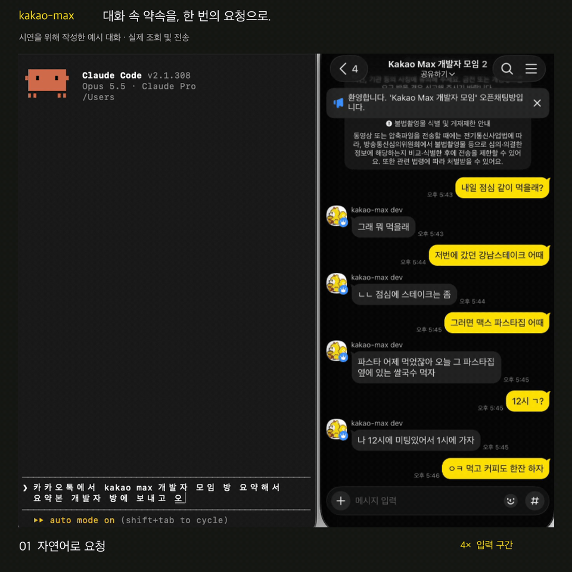
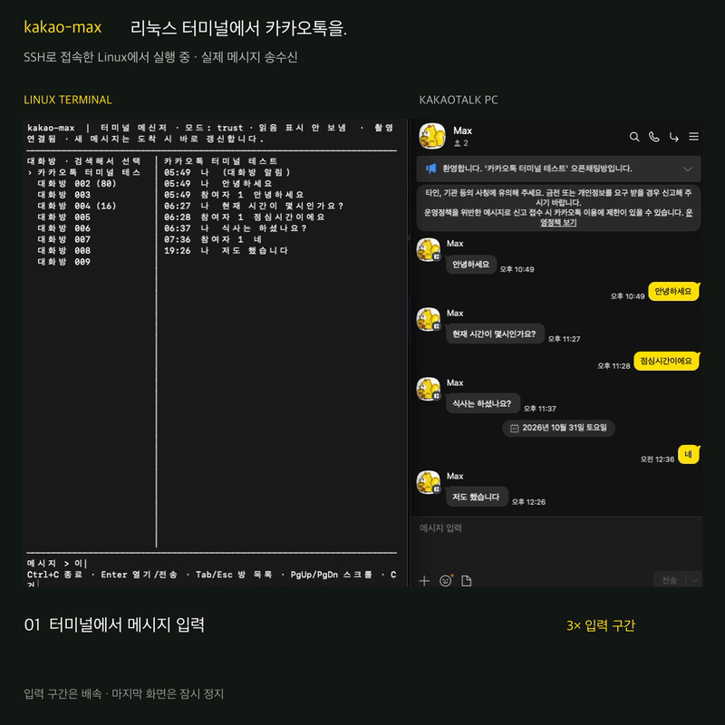
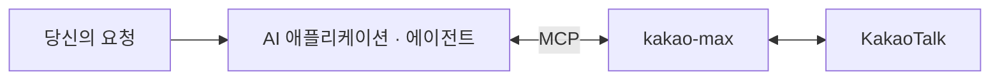

<p align="center">
  
</p>

<h1 align="center">카카오톡의 가능성을, MAX로.</h1>

<p align="center">
  내 AI가 나를 대신해 대화하고, 답장하고, 일을 이어가도록.<br>
  카카오톡을 AI 에이전트에 연결하는 <strong>헤드리스 MCP 서버</strong>.
</p>

<p align="center">
  <a href="#demo">데모</a> ·
  <a href="#use-cases">사용 장면</a> ·
  <a href="#getting-started">시작하기</a> ·
  <a href="#how-it-works">연결 구조</a> ·
  <a href="#permissions">권한 설계</a> ·
  <a href="#release-status">공개 현황</a> ·
  <a href="#faq">FAQ</a> ·
  <a href="#community">커뮤니티</a>
</p>

<p align="center">
  <a href="https://open.kakao.com/o/g448E9Ti"><strong>Kakao Max 개발자 모임 참여하기 →</strong></a><br>
  <sub>한국어로 나누는 MCP · AI 에이전트 · 자동화 개발 이야기</sub>
</p>

> [!WARNING]
> **비공식 프로젝트입니다.** kakao-max는 Kakao의 공식 제품이 아니며 Kakao와 제휴하거나 승인을 받지 않았습니다.
> 카카오톡 프로토콜을 직접 구현해 내 계정으로 접속하므로, **계정 이용 제한 등 그 결과의 책임은 사용하는 사람에게 있습니다.**
> 주로 쓰는 계정이 아닌 별도 계정으로 먼저 시험해 보세요. 받은 대화는 다른 사람의 개인정보이기도 합니다.

> [!NOTE]
> **초기 공개 버전입니다.** 기능별로 실계정에서 확인한 범위(✅)와 단위 테스트만 거친 범위(🟡)를
> [기능 매트릭스](docs/agent-capability-matrix.md)에 나눠 적었습니다.


## AI에게, 카카오톡에서 일할 수 있는 손발을.

**“내 대신 답장해 줘.” “가능한 시간을 확인해서 약속을 잡아 줘.” “작업이 끝나면 이 방에 알려 줘.”**

kakao-max는 내 AI 에이전트가 카카오톡에서 **대화의 맥락을 파악하고, 나를 대신해 답장하고, 다른 도구와 함께 일을 처리하도록** 연결합니다. 대화를 복사해 AI에게 건네고 답변을 다시 붙여 넣던 흐름을, 에이전트가 직접 이어갈 수 있습니다.

카카오톡 PC 화면을 켜 두거나 클릭을 자동화할 필요 없이, GUI 없는 서버에서 카카오톡 기능을 MCP 도구로 제공합니다. 어떤 대화에 참여하고 어디까지 맡길지는 사용자가 정합니다.

<a id="demo"></a>

## 짧은 데모로 보기

### AI가 대화를 읽고 요약 메시지 보내기

**“개발자 모임 방의 대화를 요약해서 같은 방에 보내 줘.”**

AI가 대화에서 최종 약속을 찾아 요약하고, 실제 카카오톡 대화방에 전송합니다. 왼쪽은 AI 에이전트, 오른쪽은 아이폰의 카카오톡 화면입니다.

<p align="center">
  <a href="assets/demos/summarize-demo.mp4">
    
  </a>
</p>

<p align="center">
  <sub>시연을 위해 작성한 예시 대화 · 실제 조회 및 전송 · 입력 4배속 / 처리 대기 8배속</sub>
</p>

이 시연에서는 여러 식사 후보와 시간 변경이 포함된 대화에서 **최종 장소인 쌀국수집과 오후 1시 약속**을 정리해 전송했습니다. 요약은 연결된 AI가 수행하고, kakao-max는 대화 조회와 메시지 전송 도구를 제공합니다.

이 영상은 **대화 조회 → AI의 판단 → 카카오톡 전송**이라는 기본 흐름을 보여 줍니다. 이 흐름에 내 일정, 업무 도구, 에이전트의 실행 규칙을 연결하면 답장과 일정 조율, 작업 결과 공유로 확장할 수 있습니다.

### Linux 터미널에서 카카오톡 주고받기

왼쪽은 **SSH로 접속한 Linux에서 실행 중인 터미널 메신저**, 오른쪽은 공식 카카오톡 PC 화면입니다. 터미널에서 보낸 메시지가 카카오톡에 도착하고, PC에서 보낸 답장은 터미널에 자동으로 표시됩니다.

<p align="center">
  <a href="assets/demos/terminal-demo.mp4">
    
  </a>
</p>

<p align="center">
  <sub>시연용 대화 · 실제 송수신 · 입력 2~3배속 / 도착 장면 정상 속도 / 마지막 화면 정지</sub>
</p>

이 시연은 사용자가 선택한 **trust 모드**에서 촬영했습니다. 새 메시지는 데몬의 이벤트 알림으로 갱신하며, 대기 중 반복 조회는 하지 않습니다. 조회·전송에는 기존 방 권한과 한도가 적용됩니다. ask 모드는 안읽은 방 제한을 유지합니다. 실행 방법과 모드별 동작은 [터미널 메신저 안내](docs/runbooks/terminal-messenger.md)에 정리했습니다.

<a id="use-cases"></a>

## 카카오톡에서, 에이전트에게 맡길 일들

연결한 AI와 도구를 조합해 만들고 싶은 사용 장면입니다. 위 영상에서 확인한 범위는 대화 조회와 요약 메시지 전송이며, 아래 자동화 전체의 동작을 검증한 것은 아닙니다.

<table>
<tr>
<td width="33%" valign="top">

### 나를 대신해 답장

“이 방에서 내 도착 시간을 물으면 오후 7시쯤 도착한다고 답해 줘. 다른 질문은 나에게 먼저 물어봐.”

대화의 맥락과 내가 정한 조건에 맞춰 소통을 맡깁니다.

</td>
<td width="33%" valign="top">

### 대화에서 일정 조율까지

“모임에서 나온 후보 시간과 내 캘린더를 비교해서, 가능한 시간을 방에 제안해 줘.”

카카오톡과 캘린더 도구를 연결해 대화 속 약속을 구체화합니다.

</td>
<td width="33%" valign="top">

### 작업이 끝나면 대화로

“배포가 끝나면 결과를 개발자 방에 알려 줘. 실패하면 원인과 확인할 항목도 함께 보내 줘.”

다른 도구에서 수행한 일의 결과를 필요한 사람에게 전달합니다.

</td>
</tr>
</table>

**필요할 때 한 번 부탁하거나, 정해 둔 조건에 따라 계속 맡기거나.** kakao-max는 그 작업 흐름의 카카오톡 연결을 담당합니다. 지속적인 자동 응답·예약·이벤트 감지는 연결한 에이전트와 실행 환경에서 구성하고, 캘린더·배포 같은 작업에는 해당 도구를 함께 연결합니다.

<a id="getting-started"></a>

## 시작은 세 단계로

**서버 하나 → 내 AI 연결 → 첫 요청과 권한 확인.** 자세한 순서는 [빠른 시작](docs/QUICKSTART.md)에 있습니다.

1. **내 Linux 서버에 설치합니다.** Git으로 받은 체크아웃에서 마법사를 실행합니다.

   ```bash
   npm ci
   npm run setup
   ```

   **새 Linux 서버 설치**를 고르면 환경과 Git 버전을 확인하고, 전용 `kakao-max` 서비스 계정에 설치한 뒤
   휴대폰 카카오톡 승인(또는 4자리 코드)으로 로그인합니다. 내용을 확인하고 승인하면 systemd 서비스로 등록·시작합니다.
   Linux/systemd, Git, sudo, 시스템 경로에 설치된 Node(strip-types와 `node:sqlite` 지원, CI는 Node 22)가 필요합니다.
   버전을 고정한 [npm 패키지 설치](docs/runbooks/package.md#linux-서비스-설치-버전-고정)도 있습니다. 새 서버에서 계정 입력 직전까지는 릴리스마다 자동 확인하지만, 로그인 이후는 아직 실제 서버에서 검증 전입니다.
2. **내 AI에 연결합니다.** AI를 쓰는 컴퓨터에서 마법사의 **기존 데몬 연결**을 고르면 SSH로 서버의 데몬에 붙는
   MCP 설정을 `~/.config/kakao-max/mcp.json`에 만들고, Claude Code·Codex에 바로 붙여 넣을 등록 명령을 출력합니다.
   다른 AI 클라이언트에는 `mcpServers["kakao-max"]` 항목을 등록하세요.
   서버 코드와 카카오 자격증명은 AI 컴퓨터로 옮기지 않습니다.

   AI를 쓰는 컴퓨터에는 패키지로 설치하면 됩니다. 셋 중 하나를 고르세요.

   ```bash
   npm install -g kakao-max                                   # Node.js 22.18 이상
   brew install ziesski/tap/kakao-max                         # macOS
   scoop bucket add ziesski https://github.com/ziesski/scoop-bucket && scoop install ziesski/kakao-max   # Windows
   ```

   ```bash
   kakao-max setup --config --ssh <SSH-대상>
   ```

   Git 체크아웃에서는 `npm run --silent setup -- --config --ssh <SSH-대상>`로 같은 설정을 만듭니다.
3. **범위를 정하고 요청합니다.** “홍길동에게 내일 3시에 보자고 카톡 보내 줘.” 첫 메시지는 확인 창에서 승인하고,
   “앞으로 묻지 않기”를 고르면 그 방의 후속 전송은 하루 한도 안에서 바로 보냅니다. 대화 조회와 읽음 표시는 전송 허가와 별개로 묻습니다.

확인 창은 이를 지원하는 MCP 클라이언트가 필요합니다. 확인한 클라이언트는 [AI 클라이언트 호환](docs/QUICKSTART.md#ai-클라이언트-호환)을,
확인 창이 없는 클라이언트는 [패스키 승인](docs/runbooks/passkey-approval.md)을 보세요. 설치 단계·경로·권한은
[설치 운영](docs/runbooks/mcp-setup.md), 방 허가와 운영자 상한은 [방 권한 운영](docs/runbooks/mcp-room-permissions.md)에 있습니다.

**[Releases에서 새 소식 확인하기 →](https://github.com/ziesski/kakao-max/releases)**

<a id="how-it-works"></a>

## AI와 카카오톡 사이, 하나의 브릿지



| 역할 | 맡는 일 |
| :--- | :--- |
| **당신의 AI** | 대화 맥락을 이해하고, 답변을 작성하고, 다른 도구와 함께 다음 행동을 결정합니다. |
| **kakao-max** | 권한 범위 안에서 대화를 조회하고, 메시지·사진을 전송하고, 결과를 AI에 전달합니다. |
| **당신** | 접근할 대화방과 전송 범위를 정하고, 중요한 작업을 승인합니다. |

kakao-max는 **셀프호스팅 Linux 데몬**입니다. 카카오톡 계정 연결 하나를 서버의 데몬 하나가 맡고, 에이전트는 SSH로 이어진 MCP를 통해 그 기능을 씁니다. 데몬은 서버 밖에서 접속할 수 없는 loopback 주소에서만 듣습니다.

<a id="permissions"></a>

## 연결은 편하게. 권한은 분명하게.

메신저에는 내 정보와 다른 사람의 대화가 함께 있습니다. kakao-max의 제품 설계는 다음 경계를 중심으로 합니다.

| 경계 | 설계 방향 |
| :--- | :--- |
| **어디까지 볼 수 있는가** | 대화방별로 에이전트의 내용 접근 범위를 정합니다. |
| **조회와 읽음 표시** | 내용을 조회하는 권한과 읽음 표시를 보내는 권한을 별도로 다룹니다. |
| **어디에 보낼 수 있는가** | 메시지·사진 전송은 사람이 부여한 방별 권한 안에서 수행합니다. |
| **언제 다시 확인하는가** | 영향이 큰 작업은 개별 사람 확인 절차를 거칩니다. |
| **무엇을 지시로 보는가** | 받은 메시지는 데이터로 취급하며, 그 안의 문장이 작업 지시가 되지 않도록 경계를 둡니다. |

도구별 권한과 승인 절차는 [도구·권한 계약](docs/tool-contract.md)에, 실계정 검증 결과는 [기능 매트릭스](docs/agent-capability-matrix.md)에 있습니다.

<a id="release-status"></a>

## 지금 이 저장소에는

| 들어 있는 것 | 아직 없는 것 |
| :--- | :--- |
| LOCO 프로토콜·로그인·기기 등록, 계정 데몬과 MCP 서버, CLI | 일반 사용자용 업데이트·삭제 명령 |
| 기본 도구 16개와 선택 묶음 `chats`·`friends`·`events`·`vault` | 확인 창 없는 클라이언트의 기본 승인 경로(패스키는 선택 설정) |
| Linux 설치 마법사, SSH 연결 설정, 진단·인증 복구 | 톡서랍 백업 연동(개발 저장소에서 보류 중) |
| 단위·격리 통합 테스트와 [기능 매트릭스](docs/agent-capability-matrix.md) | macOS·Windows 데몬의 OS 사용자 확인([나만 쓰는 컴퓨터에서만](docs/QUICKSTART.md#같은-서버의-다른-사용자)) |

개발 저장소의 전체 이력을 복제하는 대신, 공개에 적합한 코드를 선별해 옮겼습니다.

<a id="faq"></a>

## 자주 묻는 질문

<details>
<summary><strong>지금 설치해서 사용할 수 있나요?</strong></summary>

네. Linux 서버에서 [시작은 세 단계로](#getting-started)를 따르세요. 초기 공개 버전이므로 별도 계정으로 먼저 시험하고, 기능별 검증 범위는 [기능 매트릭스](docs/agent-capability-matrix.md)를 확인하세요.

</details>

<details>
<summary><strong>어떤 AI와 연결하나요?</strong></summary>

MCP를 지원하는 AI 애플리케이션과 에이전트가 연결 대상입니다. 승인 확인 창 지원은 클라이언트마다 다르며, 실제로 확인한 범위는 [AI 클라이언트 호환](docs/QUICKSTART.md#ai-클라이언트-호환)에 있습니다.

</details>

<details>
<summary><strong>AI 모델도 포함하나요? 대화는 어디로 전달되나요?</strong></summary>

kakao-max가 맡는 역할은 카카오톡 도구를 제공하는 서버입니다. 요청을 해석하고 결과를 정리하는 AI는 연결한 클라이언트에서 사용합니다. 허용된 조회 결과는 그 클라이언트에 전달되며, 이후 데이터 처리는 사용하는 클라이언트와 모델 제공자의 설정·정책에 따라 달라집니다.

</details>

<details>
<summary><strong>오픈소스 라이선스는 무엇인가요?</strong></summary>

[MIT 라이선스](LICENSE)입니다. 보안 문제는 [SECURITY.md](SECURITY.md), 기여 방법은 [CONTRIBUTING.md](CONTRIBUTING.md)를 보세요.

</details>


<a id="community"></a>

## 함께 만드는 kakao-max

카카오톡에서 나를 대신해 소통하는 에이전트와 일상·업무 자동화를 함께 만들어 갈 한국어 개발자 모임입니다. 처음 시작하는 분도, 직접 도구를 만드는 분도 환영합니다.

**[Kakao Max 개발자 모임 — 오픈채팅 참여하기 →](https://open.kakao.com/o/g448E9Ti)**

- **질문과 도움:** MCP·AI 에이전트 개발 질문과 설치·연결 경험을 나눠요.
- **활용 사례:** 만들고 싶은 자동화와 직접 만든 작업 흐름을 소개해 주세요.
- **아이디어와 피드백:** 필요한 기능과 개발 방향을 함께 이야기해요.

대화 캡처나 로그를 공유할 때는 이름·전화번호·인증정보 등 개인정보를 가려 주세요. 이 모임은 Kakao와 무관한 독립 개발자 커뮤니티입니다.

---

<p align="center">
  <br>
  <strong>맥스(MAX)</strong> — 카카오톡과 AI 사이를 달리는 전령 다람쥐.<br>
  <sub>Bring KakaoTalk to your AI agents through a headless MCP server.</sub>
</p>

kakao-max는 Kakao의 공식 제품이 아니며, Kakao와 제휴하거나 승인을 받은 프로젝트가 아닙니다. KakaoTalk 및 관련 상표의 권리는 각 권리자에게 있습니다.
