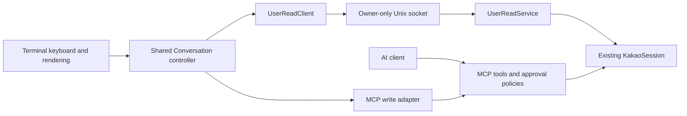

# Human reads and agent tools

The terminal messenger is a first-party account view. An agent's permission to inspect a room is a different authority. Reusing `read_messages` for the messenger made a person approve an agent read and still fail on the agent's unread-state guard. This design keeps the two paths separate without changing agent defaults.

## Authority and transport

The POSIX daemon serves `user.sock` inside its existing owner-only data directory. Both the directory and socket have their ownership/type checked; the socket is mode 0600. A live socket is never replaced. A stale socket is removed only after a failed connection probe and an inode check. Shutdown closes clients and removes only the socket it created.

The OS account that owns the daemon, or root, can use this interface. An SSH bridge must run under that account. Being allowed to connect to agent MCP is insufficient. Client names, a `human` boolean, an agent approval form, and a room grant cannot acquire this authority. There are no owner-read tools in the MCP registry, and the read service has no write, permission-change or receipt methods.

This is an OS trust boundary. It does not isolate an agent that already has arbitrary execution as the daemon owner/root. Such a process can already access the account's private files. Windows clients can use an SSH bridge to a POSIX daemon; a Windows daemon's owner IPC ACL design is not implemented by pretending POSIX mode bits apply.

## Service and client contract

`UserReadService` in core calls the existing account's human history/update methods. It does not open another Kakao connection, change agent rules, clear unread counts or send read receipts. History is exact-room and bounded to 30 messages. Updates are exact-room, read the local store, propagate removals and provider resets, and take at most 200 visible IDs.

Protocol version 1 has `describe`, `status`, `rooms`, `history` and `updates`. DTOs project the required metadata/text fields instead of exposing raw protocol records or attachment credentials. Message versions let a client omit unchanged visible content from update responses. The transport limits frame size, response size, concurrent requests and connection count; it never echoes malformed input.

`@kakao-max/client` owns the typed reader and transport lifecycle. It supports a local private socket or an explicitly configured argv bridge without invoking a local shell. The privileged `user-connect --socket ...` proxy reads no account configuration and only forwards the authenticated socket stream. Unsupported versions, old helpers and disconnections fail explicitly; there is no fallback to agent reads.

## Conversation state and UI

The shared `Conversation` controller owns room selection, a 200-message rolling cache, generation checks, updates and write state. Late history/poll results from a previous room cannot populate the current room. Polls coalesce, and an explicit refresh supersedes an older poll. Frontends receive readonly state views. Updates merge by message ID, propagate edits/deletions, and do not append repeated messages. Read failures clear displayed content and pause polling until an explicit refresh/reconnect. Only the active room is polled; idle polls do not fetch remote history.

The terminal owns keyboard focus, editing, viewport layout and rendering. `ConversationView` owns aliases and safe terminal text. It does not interpret shell output or call a command parser. Web frontends can consume the same reader/controller contract; the existing web MCP bridge remains a separate adapter until migrated explicitly, rather than silently claiming human authority.

Writes remain on the existing MCP approval/journal path. One caller-chosen request ID is allocated per operation. Read and write account identities must match at startup and before each send. Unknown outcomes retain the pending operation and block another send. Concurrent send attempts are serialized after identity checks. A malformed success response is also uncertain. Switching rooms cannot redirect an in-flight send or display its acknowledgement in another room. Human reading never grants AI reading or sending.

Read receipts remain an explicit, separate action. The terminal header states that opening/reading does not send them; server unread badges may therefore remain nonzero.

## Rollout and validation

Deploy the daemon owner API before pointing human clients at it. Agent clients remain compatible. Remote client setup must supply the owner bridge independently of the MCP tunnel. A client without an accessible owner API displays an actionable connection/version error and does not weaken policy to continue. Updating a running daemon is a separate operator action.

Tests cover unread human reads with agent deny unchanged; omitted receipts/writes; private socket permissions and stale/live path handling; frame bounds and version checks; stdio teardown; hidden room restrictions; cache/edit/delete/reset behaviour; late results; unknown writes; and draft preservation. Real-account evidence is recorded separately in the capability matrix. No production message content belongs in fixtures.
