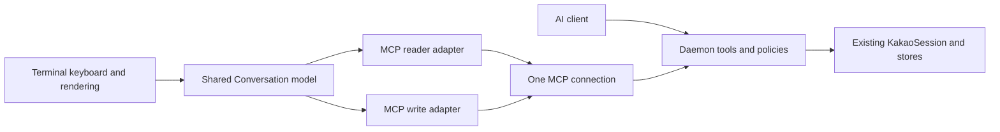

# Terminal messenger over the shared MCP interface

The terminal messenger, command CLI and AI clients use the same daemon tools and
ask/trust policies. A terminal is a user interface, not proof that the caller is
human. There is no separate owner-read socket, read protocol or privileged proxy.

`@kakao-max/client` owns UI contracts, the ordinary MCP reader adapter and the
Conversation model. The terminal owns input, layout and aliases. Core remains the
only account implementation. No client creates another account session or reads
account credentials.

The reader maps status/rooms/history/updates to existing get_status/list_chats/
read_messages calls. It never requests a permission fallback or changes modes.
The header displays the daemon mode; ask/trust applies to every client of that
daemon, not a single invocation. Ask's unread-state restriction remains separate
from a read approval. Trust lifts that restriction, while explicit deny rules and
operator ceilings still apply. Reads do not send read receipts in either mode.
The existing mode setup and unchanged risk notice are documented in
[agent modes](agent-mode-and-layers.md).

Opening a room loads 30 messages. The recent feed uses its returned sequence cursor;
older replayed messages cannot expand the initial history window. Polls are
coalesced and caches are bounded to 200 messages. Cursors are owned by the model's
room generation, so late responses cannot advance a new room's cursor. Explicit
refresh reloads recent history and resets the feed cursor. MCP recent is a live
message feed, not a deletion snapshot; complete automatic propagation of past
edits/deletions is not promised. Restart/disconnection requires reconnection.

The UI pauses polling after one-time read approval instead of repeatedly asking.
Permission errors stop polling and are displayed without weakening policy. Only
explicit keyboard input answers approval forms; demo mode has no approval dialog.

Writes retain the existing MCP approval/journal and caller UUID. The shared model
checks account identity and room generation before submission, prevents concurrent
submissions and retains uncertain outcomes rather than retrying with a fresh ID.
Alias mode is presentation only and does not hide ordinary message contents.

Tests cover the adapter's exact tool arguments, mode and policy propagation, feed
cursor validation, history failures and old-message filtering, plus model races,
cache limits, draft preservation and unknown writes. Real-account evidence is
tracked separately in the [capability matrix](../agent-capability-matrix.md).
